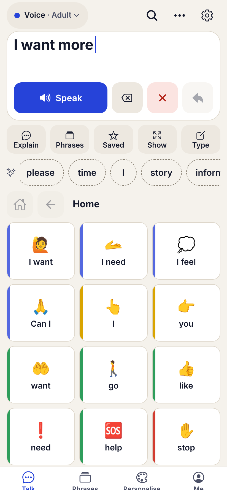
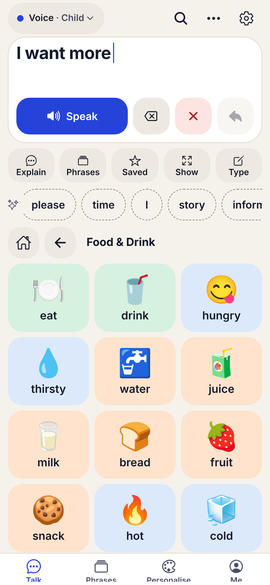
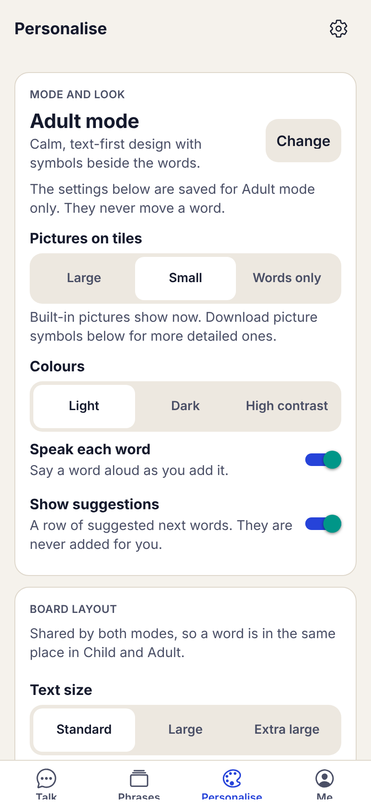

# Voice: an AAC app for people who can't rely on speech

Voice is an augmentative and alternative communication (AAC) app. You build a message from word and picture tiles, and the phone speaks it. Its word prediction runs on the device, works offline and can explain each suggestion it makes.

**[Try it in your browser](https://paulmartinmcneill.com/demos/aac-app/)** (guest mode, no account) · **[Case study](https://paulmartinmcneill.com/projects/ai-aac-app/)** · **[Caregiver dashboard](https://github.com/mcneillium/ai-powered-aac-dashboard)**

| Adult mode | Child mode | Personalise |
| --- | --- | --- |
|  |  |  |

## What it does

- **Boards for adults and children.** Both modes share one layout, so every word stays in the same place when the person switches. Child mode uses colourful, picture-led tiles.
- **Word prediction on the device.** A small n-gram model (33.8 KB) suggests the next word with no network connection. If the person opts in, it also learns from sentences they actually speak. Taps and deleted words are never learned.
- **Suggestions you can question.** Each suggestion can say why it was offered, for example "You often say this next", "Fits this topic" or "Common next word".
- **"Help me explain."** One tap offers repair phrases ("That's not what I meant", "Please wait, I am still typing") and rewordings of the current message. Nothing is replaced without asking, and Undo keeps the original.
- **Phrases by place.** Ready phrases are grouped by place: home, meals, school, work, appointments and more. Any phrase can be saved as a favourite.
- **Access options.** Switch scanning (automatic and step) for people who can't tap, high-contrast colours, larger text, and speaking each word as it is added.
- **Offline first.** The board, prediction and speech all work without a connection. Firebase sync and the optional AI phrase suggestions add to the app but are never required.

## How the prediction works

The engine lives in [`src/services/prediction/`](src/services/prediction). It is plain JavaScript with no TensorFlow, no network access, and no logging of sentence content.

- **Base model.** An interpolated trigram, bigram and unigram model with absolute discounting. It is trained at build time on 666 short AAC-style sentences written for this project, plus every board label.
- **Personal layer (opt-in).** Counts of the person's own words and phrases, which decay with a 45-day half-life. They are stored on the device, capped at 5,000 n-grams, and can be exported, imported and cleared.
- **Reranker.** A seven-feature linear model reorders the top candidates.

On a held-out evaluation using synthetic personas, the shipped system put the right word first 47.9% of the time and in the top three 69.0% of the time. It cut selections by 42.4%. The previous LSTM approach scored 34.8%, 54.3% and 34.4% on the same test.

**These figures come from hand-written synthetic data.** They show how the algorithms behave; they are not evidence of real-world benefit. The method, every result and a one-command reproduction are in [docs/ai/prediction-evaluation.md](docs/ai/prediction-evaluation.md).

A separate small pilot with 7 users found 35–50% faster time-to-utter for common phrases, and caregivers reported 40% higher satisfaction with session clarity. The pilot records are not in this repository.

## Run it

You need Node 20 and npm.

```bash
git clone https://github.com/mcneillium/ai-powered-aac-app.git
cd ai-powered-aac-app
npm ci --legacy-peer-deps
npx expo start            # press w for the browser, or scan the QR code with Expo Go
```

Firebase settings come from `EXPO_PUBLIC_FIREBASE_*` environment variables; see [`firebaseConfig.js`](firebaseConfig.js). Without them the app still runs, but cloud sync and sign-in are off.

## Tests

```bash
npx jest
```

The suite has 57 test files with 833 tests. They cover the prediction engine, speech, settings upgrades, switch scanning, offline start-up and data deletion. GitHub Actions runs lint, the tests and an Expo config check on every push and pull request.

## Project layout

```
src/screens/              board, phrases, personalise, insights, studio and account screens
src/services/prediction/  the on-device prediction engine
src/services/             speech, switch scanning, "Help me explain", storage, optional AI client
src/__tests__/            Jest tests
functions/                Firebase Cloud Functions for the optional AI suggestions
docs/                     design, AI method and evaluation, security, release checklists
```

## Privacy

The app never logs what someone says. Learning is off until the person turns it on, and "Delete what Voice has learned" and "Delete my words and messages" clear it from the device.

## Licence

0BSD. Third-party notices are listed in the app's Licences screen and in [docs/legal/](docs/legal).

The earlier, longer README is kept at [docs/archive/README-2025.md](docs/archive/README-2025.md). Some of its claims (for example, that prediction uses TensorFlow.js) no longer match the code.
