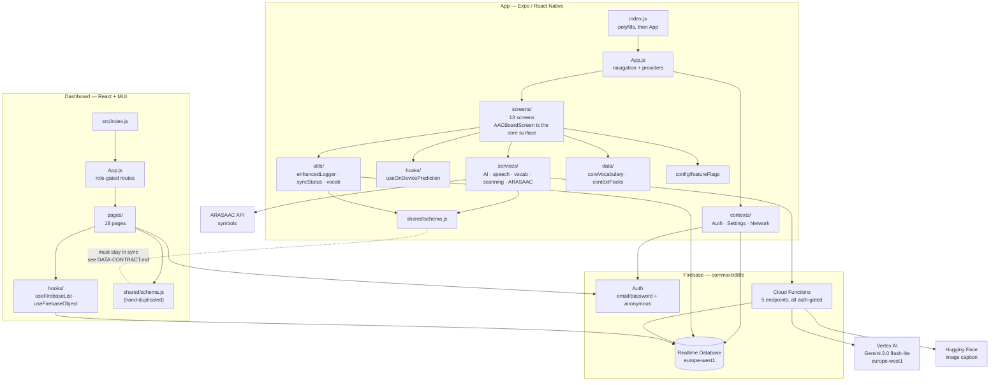

# CommAI — architecture

Two independently deployed codebases sharing one Firebase project and one
hand-duplicated schema file. Last verified 2026-08-08.

| Repo | Stack | Role |
|---|---|---|
| `ai-powered-aac-app` | Expo SDK 54 / RN 0.81.5 / React 19 | the AAC device the user speaks with |
| `ai-powered-aac-dashboard` | React 18 + MUI 6 + CRA/craco | what caregivers, SLTs and admins see |

Backend: Firebase `commai-b98fe` — Realtime Database (`europe-west1`), Auth,
five Cloud Functions (`functions/index.js`, Node 20, currently deployed to
**us-central1**), Hosting for the dashboard.

---

## Module graph

---

## The critical path: tap → speech

Every hop, with the file and function. This is the sequence that must never
break, and the one that must work with no network.

| # | What | Where |
|---|---|---|
| 1 | User taps a vocabulary button | `screens/AACBoardScreen.js` → `handleButtonPress` → `addWord` |
| 2 | Word appends to the utterance bar | `AACBoardScreen` `sentenceWords` state |
| 3 | **Speech fires immediately** | `services/speechService.js` → `speak()` → `expo-speech`. No network, no await on anything remote. This is why the board feels like a voice. |
| 4 | Selection recorded for personalisation | `services/aiProfileStore.js` → `recordWordSelection`, and `hooks/useOnDevicePrediction` → `recordTap` |
| 5 | Predictions refresh (4 tiers, each superseding the last) | `AACBoardScreen` suggestion effect: bigram → personal ranking → on-device LSTM → Vertex |
| 5a | tier 1 — on-device TF.js LSTM | `hooks/useOnDevicePrediction.js`, `services/improvedModelLoader.js`, model in `assets/tf_model/word_prediction_tfjs/` |
| 5b | tier 2 — personalisation | `services/aiProfileStore.js` (`getBigramPredictions`, `scoreWithExplanation`) |
| 5c | tier 3 — Vertex Gemini | `services/vertexAISuggestions.js` → `services/aiBackend.js` → CF `aacPhraseSuggestions`. **Credentials live in the function, never in the client.** |
| 6 | User commits the utterance | `speakSentence` → `speechService.speak` → `sentenceHistoryStore.addSentenceToHistory` |
| 7 | Event queued | `utils/enhancedLogger.js` → `logEvent`. Metadata is filtered against `ALLOWED_LOG_FIELDS` **before** the logger's own fields, so a caller cannot override them. |
| 8 | Queue drains to Firebase | `syncLogsToFirebase` → `userLogs/{uid}/{pushId}`. Rejected entries are dropped, transient failures retried with exponential backoff. Anonymous sessions never sync. |
| 9 | Retention | CF `pruneUserLogs`, daily, 30 days |
| 10 | Dashboard reads | `pages/Logs.js`, `AdminDashboard.js`, `CaregiverDashboard.js` — **currently reading the wrong path shape, see DATA-CONTRACT.md CB-1** |

**Fallback guarantee:** each tier is individually wrapped, degrades to the tier
below, and tier 1 degrades to the static `data/coreVocabulary.js` board, which
has no network dependency at all. `SettingsContext` loads from AsyncStorage
first and always clears `loading` even on failure. Communication survives total
backend loss.

---

## Where things live (app)

- `App.js` — navigation, providers, non-blocking model/profile/vocab loads, `initLogger()`.
- `index.js` — entry; sets IndexedDB polyfills **before** any Firebase import.
- `firebaseConfig.js` — config from `EXPO_PUBLIC_*`, **inlined at bundle time**.
- `src/screens/` — one file per screen. `AACBoardScreen.js` is ~950 lines with
  nine distinct responsibilities; splitting it is a backlog item.
- `src/services/` — AI tiers, speech, vocab stores, switch scanning, ARASAAC.
- `src/contexts/` — `AuthContext`, `NetworkContext`, `SettingsContext`.
- `src/config/featureFlags.js` — all flags default OFF.
- `src/shared/schema.js` — RTDB path constants. Incomplete: `customVocab` and
  `vocabRequests` are missing and therefore hardcoded at their call sites.
- `database.rules.json`, `storage.rules` — security rules; **neither has been
  deployed**.
- `functions/index.js` — five endpoints, all requiring a Firebase ID token.

## Build and quality surface

- `scripts/gates.mjs` — typecheck, lint, jest, rules, import-case, expo-doctor,
  production bundle, dependency tree. Pre-existing failures are gated on not
  getting worse against `scripts/gates.baseline.json`; bundle success and
  import-case are absolute.
- `scripts/check-import-case.mjs` — resolves every relative import the way Metro
  does and asserts exact on-disk casing. This is the guard against the
  versionCode 19 failure class; see `docs/release/metro-bundling-postmortem.md`.
- `scripts/preflight.mjs` — `npm ci` + sweep + gates + bundle + a check that the
  bundle contains a resolved Firebase config. Run before spending EAS minutes.
- `test/rules/` — 67 emulator-backed security-rules cases. Needs JDK 21+.
- `.github/workflows/ci.yml` — the gate suite on every PR, no secrets, no deploy.

## Known structural debt

Dead files (`src/mocks/idb-mock.js`, `src/styles/commonStyles.js`); god files
(`AACBoardScreen.js` ~950, `aiProfileStore.js` ~500, `enhancedLogger.js` ~470,
dashboard `AdminDashboard.js` ~590); two hand-duplicated `schema.js` files
already five paths apart; RTDB paths hardcoded at ~12 call sites across both
repos. All catalogued with file:line in
`.claude/overnight/2026-08-08/FINDINGS.md`.
